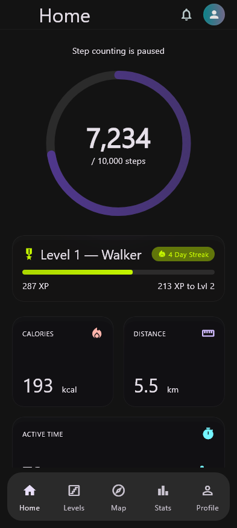
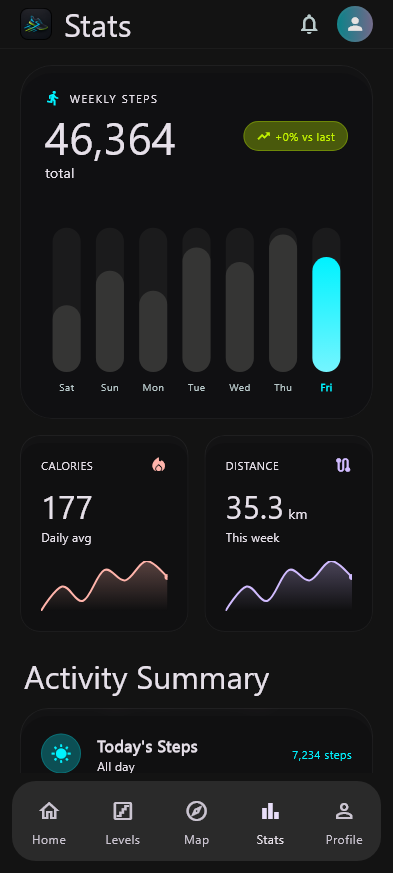
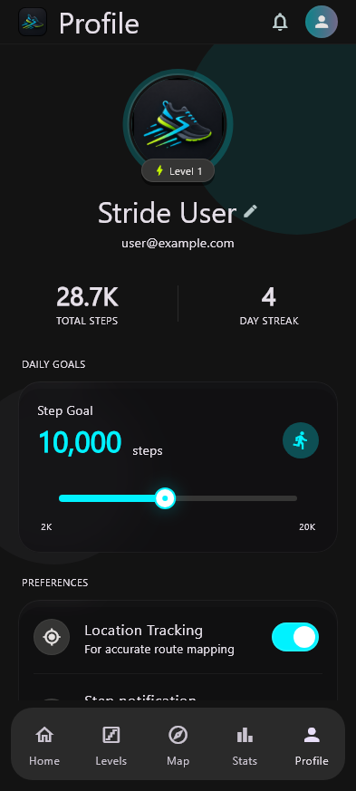
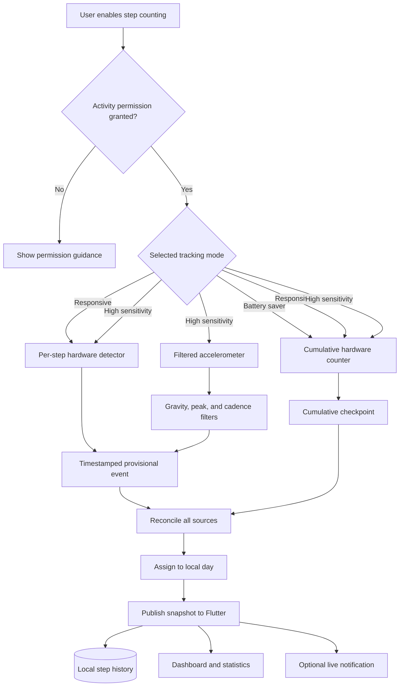
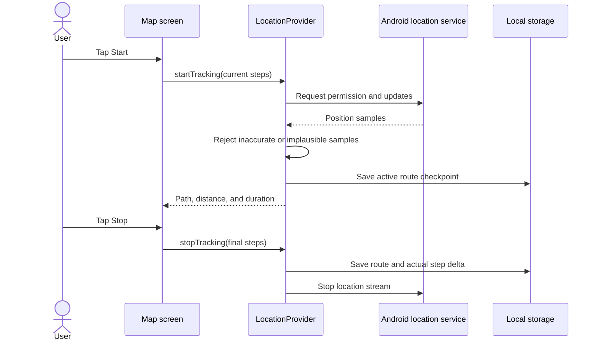
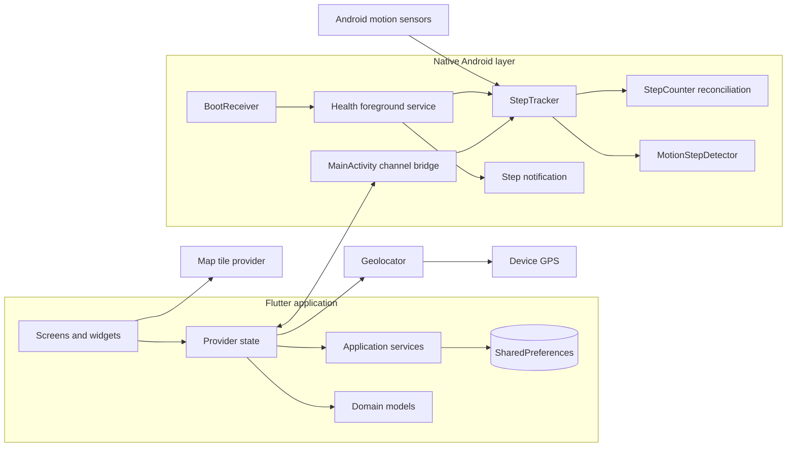
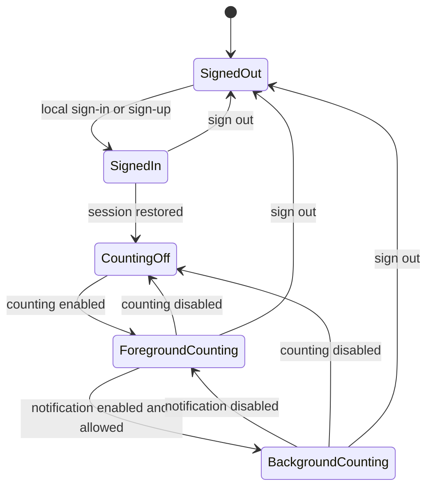

# StrideUp

<p align="center">
  
</p>

<h3 align="center">Walk more. Understand your activity. Keep your data on your device.</h3>

<p align="center">
  StrideUp is an Android-first fitness tracker built with Flutter and native Kotlin sensor handling.
  It combines responsive step counting, local activity history, GPS route recording,
  progress levels, and battery-aware controls in one focused application.
</p>

<p align="center">
  <a href="https://github.com/BlackAlpha-debug/strideup/actions/workflows/flutter.yml"></a>
  
  
  
  
</p>

<p align="center">
  <a href="#overview">Overview</a> ·
  <a href="#features">Features</a> ·
  <a href="#how-step-tracking-works">Step tracking</a> ·
  <a href="#architecture">Architecture</a> ·
  <a href="#getting-started">Getting started</a> ·
  <a href="#privacy-and-security">Privacy</a>
</p>

---

## Overview

StrideUp is designed for people who want useful daily movement feedback without creating a cloud account or sending their activity history to an application backend. It reads Android motion sensors, maintains daily totals, estimates walking distance and active calories, records user-started GPS routes, and presents progress through goals, streaks, statistics, XP, and levels.

The application uses Flutter for its interface, application state, calculations, and local data model. A small Kotlin layer owns the Android step sensors and foreground service so counting can remain reliable when Flutter is paused or the screen is locked. The boundary between the two layers is implemented with Flutter method and event channels.

StrideUp currently focuses on Android. The repository contains Flutter-generated projects for other platforms, but continuous step sensing, boot recovery, and live activity notifications depend on the Android implementation.

### Product principles

- **Local-first:** profile, session, steps, settings, and routes remain on the device.
- **User controlled:** step counting, live notifications, GPS recording, and sensitivity can be controlled independently where Android permits it.
- **Honest estimates:** distance and calories are labelled as estimates and use the user's saved measurements.
- **Battery aware:** the user can select a low-power sensor mode or disable counting completely.
- **Resilient:** sensor totals are reconciled, active routes are checkpointed, and opted-in tracking can recover after a normal process or device restart.
- **Phone friendly:** layouts account for narrow screens, larger text, gesture navigation, and three-button navigation insets.

## Screenshots

| Home | Statistics | Profile and settings |
|:---:|:---:|:---:|
|  |  |  |

The screenshots are generated from the real Flutter widgets with representative local data. They do not contain a real user's account or activity history.

## Features

### Daily activity dashboard

- Circular progress indicator for the current daily step goal.
- Current step count with automatic local-day rollover.
- Estimated active calories based on recorded steps, body weight, and step length.
- Estimated distance in kilometres or miles.
- Approximate active minutes derived from step activity.
- Clear permission and tracking status messages.
- Direct access to Android settings when a permission has been blocked.

### Native Android step tracking

- Uses Android's hardware `TYPE_STEP_DETECTOR` when available for quick updates.
- Uses `TYPE_STEP_COUNTER` as a cumulative correction source.
- Can use filtered accelerometer motion in High sensitivity mode.
- Reconciles sources instead of adding them together, reducing duplicate steps.
- Persists checkpoints so service and process restarts do not reset the user's total.
- Rejects duplicate, out-of-order, and implausible sensor events.
- Unregisters every motion sensor when the user turns step counting off.
- Can restart opted-in background tracking after boot or package replacement when Android permissions still allow it.

### Live notification

- Optional ongoing notification showing today's steps and estimated calories.
- Uses the selected app accent and Android's system notification template.
- Updates are throttled to avoid refreshing the notification for every individual sensor event.
- Notification consent is requested at the moment it becomes useful.
- A denied permission is remembered so the app does not repeatedly interrupt the user.
- Notification and counting preferences are stored independently.

Android requires a visible notification for a long-running foreground health service. With the live notification disabled, StrideUp continues counting while the application is visible, but it does not promise unrestricted background execution.

### GPS route recording

- Route recording starts only after an explicit user action.
- Uses a foreground location service during an active recording so it can continue with the screen locked.
- Stores the recorded coordinates, start time, elapsed time, distance, and actual step-counter delta.
- Filters low-quality samples, impossible jumps, and tiny GPS movements.
- Checkpoints the active route and recovers an interrupted recording as a saved partial route.
- Supports selecting and deleting saved routes.
- Builds the density view only from the user's recorded route points.
- Retains up to 100 saved routes in local storage.

### Statistics and history

- Rolling seven-day activity chart ending on the current day.
- Previous-week comparison and percentage trend.
- Weekly step total, distance, and average calorie estimate.
- Local calendar labels generated from the same dates as the stored data.
- Streak calculation based on completed daily goals.
- Responsive statistics cards for narrow phone screens.

### Goals, XP, and levels

StrideUp converts every 100 steps into one XP. XP unlocks ten progression levels:

| Level | Title | XP required | Equivalent lifetime steps |
| ---: | --- | ---: | ---: |
| 1 | Walker | 0 | 0 |
| 2 | Roamer | 500 | 50,000 |
| 3 | Pathfinder | 1,500 | 150,000 |
| 4 | Nomad | 3,000 | 300,000 |
| 5 | Trailblazer | 5,000 | 500,000 |
| 6 | Voyager | 8,000 | 800,000 |
| 7 | Summit Seeker | 12,000 | 1,200,000 |
| 8 | Endurance | 18,000 | 1,800,000 |
| 9 | Titan | 26,000 | 2,600,000 |
| 10 | Legend | 36,000 | 3,600,000 |

The Levels screen shows the current title, progress to the next level, completed milestones, and the broader journey.

### Personalization

- Editable display name.
- Configurable daily step goal.
- Body weight and average step length for personalised estimates.
- Kilometre or mile distance display.
- Light, dark, and system theme behavior.
- Multiple accent colors shared with the live notification.
- Battery saver, Responsive, and High sensitivity tracking modes.
- Fine sensitivity adjustment for motion-based detection.
- Visible active sensor mode for troubleshooting.

### Local account and session

- Create an account stored only within the installation.
- Sign back in after logout using the locally saved account.
- Restore the authenticated session when the application reopens.
- Remain signed in until Sign out is explicitly selected.
- Store a salted, repeatedly derived verifier instead of the plain-text password.
- Stop active sensor and route tracking during logout.

The bundled `test@strideup.com` / `stride123` account is a public demonstration credential. It is not connected to a server or a private user.

## How step tracking works

Android phones differ in the motion sensors they expose and in how aggressively the operating system pauses background work. StrideUp uses multiple sensor paths so it can favor power use, responsiveness, or sensitivity without pretending that raw accelerometer movement is always a step.



### Tracking modes

| Mode | Sensor strategy | Responsiveness | Battery use | Recommended for |
| --- | --- | --- | --- | --- |
| Battery saver | Cumulative hardware step counter | Updates may arrive in batches | Lowest | Long daily use when the phone's counter is reliable |
| Responsive | Hardware detector with cumulative correction | Fast | Low to moderate | Most users and supported modern phones |
| High sensitivity | Responsive sources plus cadence-filtered accelerometer peaks | Fast | Highest of the three | Phones that miss slow or soft steps |

High sensitivity is an additional candidate source, not a multiplier. Motion events must satisfy timing, gravity, peak, and cadence constraints before they become provisional steps. The next cumulative hardware checkpoint reconciles those provisional events.

### Counting and notification behavior

| Step counting | Live notification | Result |
| --- | --- | --- |
| Off | Either value | All step and motion sensors are unregistered; saved history remains available |
| On | Off | Counting runs while the app is active; no ongoing step notification is shown |
| On | On, permission granted | Foreground health service supports background and screen-off counting |
| On | On, permission denied | The app explains that notifications are blocked and offers Android settings |

### Accuracy expectations

No phone application can guarantee a medically precise step count. Accuracy depends on device hardware, carrying position, walking style, firmware, and OEM power controls. The sensitivity control changes StrideUp's motion filtering; it cannot change thresholds inside an Android hardware step sensor.

Calorie output is also an estimate. StrideUp currently estimates horizontal walking energy as:

```text
distance_km = steps × step_length_metres ÷ 1000
active_kcal = distance_km × body_weight_kg × 0.5
```

This represents approximate active walking energy and excludes resting metabolism.

## Route recording flow



Route distance comes from accepted GPS coordinates. Route steps come from the actual step counter between start and stop; the application does not fabricate route steps from distance.

## Architecture

StrideUp separates presentation, application state, platform integration, and Android sensor ownership.



### Responsibility boundaries

| Layer | Responsibilities |
| --- | --- |
| Screens and widgets | Rendering, navigation, input, accessible layout, user feedback |
| Providers | Feature state, orchestration, calculated view data, lifecycle reactions |
| Flutter services | Local authentication, persistence, permissions, location, platform channel calls |
| Models and utilities | Route/profile data, units, formatting, step calculations, level progression |
| Kotlin tracker | Sensor registration, event validation, reconciliation, checkpoints, daily attribution |
| Android services | Foreground lifetime, notification updates, location continuity, boot recovery |

More detailed component, state, and sequence diagrams are available in [docs/ARCHITECTURE.md](docs/ARCHITECTURE.md).

## Data and persistence

StrideUp uses device-local preferences rather than a remote database.

| Data | Primary owner | Persistence behavior |
| --- | --- | --- |
| Local account and session | `AuthService` and `UserProvider` | Restored on launch until explicit sign-out |
| Daily and lifetime steps | Native tracker and `StepProvider` | Checkpointed and reconciled across normal restarts |
| Goal, units, measurements, sensitivity | `StorageService` | Applied to dashboard and notification estimates |
| Completed routes | `LocationProvider` | JSON data capped at the 100 newest routes |
| Active route | `LocationProvider` | Temporary checkpoint recovered as a partial route |
| Theme and accent | `ThemeProvider` | Restored at startup and forwarded to Android notification styling |

Clearing application data removes the local account, session, preferences, and activity history. Uninstall behavior may also depend on the device's Android backup configuration.

## Application lifecycle



During a normal application reopen, the saved session is restored before deciding whether to show authentication or the main navigation. Explicit sign-out stops native tracking, stops an active route, clears the session, and returns to the sign-in screen.

## Privacy and security

StrideUp does not include an analytics SDK, advertising SDK, cloud account backend, or remote activity database.

### What stays local

- Name and email used by the local account.
- Password salt and derived verifier.
- Signed-in session state.
- Daily and lifetime step totals.
- Goals, units, weight, step length, sensitivity, and theme preferences.
- GPS route coordinates and route history.

### Network access

Core sign-in, step tracking, statistics, and local persistence do not need a StrideUp server. The map screen uses internet access to retrieve map tiles from its configured public tile provider. Android and dependency tooling may make their own platform-level requests outside the app's local data model.

### Repository safety

The repository ignores common private files:

- `.env` and `.env.*`
- Android `key.properties`
- JKS and keystore files
- PEM, P12, PFX, DER, and private key files
- Firebase configuration files
- files named `secrets.*`
- machine-local Android SDK configuration

Production signing material and service credentials must remain outside Git. See [docs/SECURITY.md](docs/SECURITY.md) for the complete security boundary and reporting guidance.

## Permissions

| Android permission | When it is used | User-visible reason |
| --- | --- | --- |
| Physical activity | When step counting is enabled | Read supported hardware step sensors |
| Notifications | When live step status or an active foreground operation needs it | Display ongoing tracking state on Android 13+ |
| Foreground service: health | During opted-in background step tracking | Keep the health sensor owner alive with a visible notification |
| Fine/coarse location | After the user starts a route | Record accepted route coordinates |
| Foreground service: location | During an active route | Continue route collection when the screen is locked |
| Boot completed | After a restart, for a previously enabled configuration | Restore eligible opted-in step tracking |
| Internet | When map tiles are visible | Load the map background |

An explicit Android **Force stop** prevents automatic restart until the application is opened again. This is an operating-system rule and is not bypassed by StrideUp.

## Getting started

### Prerequisites

- Git
- Flutter 3.44.7 or a compatible stable version
- Dart 3.12 or later
- Android Studio or Android command-line SDK tools
- JDK 21 for the current Android build tooling
- Android SDK with the project's compile and target platforms installed
- Android 10 or later for the supported mobile experience

A physical Android phone is recommended. Emulators can exercise the interface and tests but do not reproduce real step-sensor behavior.

### Clone and install dependencies

```bash
git clone https://github.com/BlackAlpha-debug/strideup.git
cd strideup
flutter pub get
```

### Check the environment

```bash
flutter doctor -v
flutter devices
```

Resolve any Android toolchain errors reported by `flutter doctor` before running the app.

### Run in development

```bash
flutter run
```

Select a specific device when more than one is connected:

```bash
flutter devices
flutter run -d <device-id>
```

## Build and install

### Debug APK

```bash
flutter build apk --debug --no-pub
```

Output:

```text
build/app/outputs/flutter-apk/app-debug.apk
```

Install it on a connected Android device:

```bash
adb install -r build/app/outputs/flutter-apk/app-debug.apk
```

### Release APK

```bash
flutter build apk --release --no-pub
```

Output:

```text
build/app/outputs/flutter-apk/app-release.apk
```

The checked-in Android project currently uses development signing so a local release-mode APK can be installed. Before publishing to an application store, configure a private production keystore outside the repository and review the application ID, version, store metadata, privacy disclosure, and release optimization settings.

## Validation and tests

### Static analysis

```bash
flutter analyze --no-pub
```

### Flutter unit and widget tests

```bash
flutter test --no-pub
```

The Flutter suite covers:

- local sign-up, sign-in, session restoration, and logout;
- independent notification and counting preferences;
- permission-denied behavior;
- duplicate snapshots, local-day history, and lifetime totals;
- route filtering, persistence, recovery, and step deltas;
- dates, units, pace, distance, and calorie calculations;
- bottom navigation clearance with 24, 48, and 72 logical-pixel system insets;
- narrow-screen layouts at increased text scale.

### Native Android tests

macOS or Linux:

```bash
cd android
./gradlew testDebugUnitTest
```

Windows PowerShell:

```powershell
Set-Location android
.\gradlew.bat testDebugUnitTest
```

The native suite exercises sensor initialization, duplicate input, paused periods, device reboot identity changes, decreasing cumulative values, provisional reconciliation, cadence validation, isolated-motion rejection, and sensitivity thresholds.

### Documentation screenshots

The screenshot harness builds the real widget tree with anonymous sample preferences:

```bash
flutter test --no-pub --update-goldens tool/readme_screenshots_test.dart
```

Set `README_FONT_PATH` if the default system font cannot be located. Set `FLUTTER_ROOT` if the Flutter installation cannot be inferred from the Dart executable.

### Continuous integration

The GitHub Actions workflow runs on pushes and pull requests to `main`:

1. Install the pinned Flutter and Java toolchains.
2. Resolve packages.
3. Run static analysis.
4. Run Flutter tests.
5. Run native Android tests.
6. Build a debug APK.

Dependabot checks Dart packages weekly and GitHub Actions monthly.

## Project structure

```text
strideup/
├── .github/
│   ├── dependabot.yml
│   └── workflows/flutter.yml
├── android/
│   └── app/src/
│       ├── main/kotlin/com/strideup/stride_up/
│       │   ├── BootReceiver.kt
│       │   ├── MainActivity.kt
│       │   ├── MotionStepDetector.kt
│       │   ├── StepCounter.kt
│       │   ├── StepTracker.kt
│       │   └── StepTrackingService.kt
│       └── test/kotlin/com/strideup/stride_up/
├── assets/
│   └── Stride Up.png
├── docs/
│   ├── images/
│   ├── ARCHITECTURE.md
│   └── SECURITY.md
├── lib/
│   ├── models/
│   ├── providers/
│   ├── screens/
│   ├── services/
│   ├── theme/
│   ├── utils/
│   ├── widgets/
│   └── main.dart
├── test/
├── tool/
│   └── readme_screenshots_test.dart
├── pubspec.yaml
└── README.md
```

### Important source files

| File | Purpose |
| --- | --- |
| `lib/main.dart` | Storage initialization, provider composition, theme, and session-based entry flow |
| `lib/providers/step_provider.dart` | Flutter step state, preferences, history, estimates, and native snapshots |
| `lib/providers/location_provider.dart` | Route lifecycle, GPS filtering, checkpoints, selection, and deletion |
| `lib/services/auth_service.dart` | Local account verification and persistent session management |
| `lib/services/step_tracking_service.dart` | Flutter method/event channel wrapper |
| `android/.../StepTracker.kt` | Native sensor ownership, source selection, persistence, and reconciliation |
| `android/.../MotionStepDetector.kt` | High-sensitivity accelerometer filtering and cadence validation |
| `android/.../StepTrackingService.kt` | Android foreground health service and ongoing notification |
| `android/.../BootReceiver.kt` | Eligible service recovery after boot and application replacement |

## Configuration guide

### Daily goal

The daily goal affects the home progress ring and streak calculation. Changing it does not alter previously recorded daily step totals.

### Weight and step length

Weight affects the active-calorie estimate. Step length affects both distance and calories because calories use estimated walking distance. Existing raw step totals remain unchanged when these measurements change.

### Distance unit

Changing between kilometres and miles only changes presentation. Stored route geometry and metric distance remain consistent.

### Sensitivity

Start with **Responsive**. Try **High sensitivity** when slow or soft walking is missed. Choose **Battery saver** when cumulative totals are reliable and immediate visual updates are less important. Evaluate a mode over a normal walk rather than by shaking the phone, because the high-sensitivity path intentionally rejects isolated motion.

## Redmi and HyperOS guidance

StrideUp's responsive layout and navigation clearance were specifically checked at a Redmi-like 393 logical-pixel width with multiple bottom system insets. Physical-device behavior still depends on the installed HyperOS version and its battery policy.

If screen-off updates stop on a Redmi device:

1. Confirm **Step counting** and **Step notification** are enabled in StrideUp.
2. Allow Physical activity and Notifications in Android settings.
3. Confirm the ongoing StrideUp notification is visible.
4. Review the app's battery setting and remove aggressive restrictions if continuous background counting is desired.
5. Reopen StrideUp after using Android's Force stop.

Battery-setting labels vary across HyperOS releases. StrideUp does not automatically change system battery policy.

## Troubleshooting

### Steps are not changing

- Confirm Physical activity permission is allowed.
- Confirm **Step counting** is enabled.
- Walk normally for a short period; cumulative sensors may publish in batches.
- Change from Battery saver to Responsive.
- Try High sensitivity if the hardware detector misses slow steps.
- Reopen the app after an Android Force stop.
- Check the active sensor label in Profile settings.

### The notification is missing

- Enable **Step notification** in Profile.
- Allow Notifications in Android settings.
- Check that the StrideUp notification channel is not individually disabled.
- Keep step counting enabled; there is no reason to show a live step notification when counting is stopped.

### The bottom navigation is obscured

- Update to the latest build from this repository.
- Restart after changing between gesture and three-button navigation.
- Check whether a forced display size or accessibility scale is unusually large.
- Open an issue with the phone model, Android/HyperOS version, navigation mode, and screenshot.

### A route does not start

- Enable device Location.
- Grant location permission.
- Move outdoors or to an area with a usable GPS signal.
- Wait for an accurate sample; StrideUp ignores positions with poor accuracy.

### A route contains fewer points than expected

The route filter ignores samples with accuracy worse than 40 metres, movement under 2 metres, non-increasing timestamps, or implied speed above 8 metres per second. This reduces stationary drift and impossible jumps but can remove samples in difficult GPS conditions.

### Sign-in does not work on another device

Accounts are local to one installation. There is no cloud account, synchronization, password reset email, or cross-device login.

### Gradle reports the wrong Java version

Point `JAVA_HOME` to a JDK 21 installation, such as the runtime bundled with a current Android Studio release, and reopen the terminal before running Gradle again.

## Current limitations

- Native continuous step tracking is implemented for Android only.
- Activity data does not synchronize between devices.
- Local accounts do not have email verification or remote password recovery.
- Clearing application data removes locally stored activity and account state.
- Calorie, distance, active-minute, and pace values are estimates rather than medical measurements.
- Exact attribution is impossible when Android reports only a cumulative remainder spanning an unknown midnight boundary; StrideUp keeps that remainder marked as undated instead of inventing a date.
- OEM battery restrictions can delay or stop background work.
- Map tiles require network access, although saved route coordinates remain local.
- Production store signing and distribution configuration are not included.

## Development workflow

1. Create a feature or fix branch.
2. Keep platform-specific sensor behavior in the Android layer and product state in providers.
3. Add tests for reconciliation, persistence, calculations, or layout behavior when the change affects them.
4. Run analysis and both test suites.
5. Build the debug APK.
6. Test sensor or GPS changes on physical hardware.
7. Open a pull request with the behavior change, validation performed, and any hardware limitations.

Useful commands:

```bash
flutter pub get
dart format lib test tool
flutter analyze --no-pub
flutter test --no-pub
flutter build apk --debug --no-pub
```

## Contributing

Issues and focused pull requests are welcome. A useful issue includes:

- the expected and observed behavior;
- device model and Android version;
- HyperOS or other OEM version when relevant;
- selected tracking mode;
- whether the app was visible, backgrounded, or screen-off;
- permission and notification state;
- reproducible steps;
- screenshots or sanitized logs that do not expose routes or private account information.

Avoid posting real route coordinates, email addresses, credentials, signing files, or API tokens in an issue.

## Frequently asked questions

### Does StrideUp upload my steps or routes?

The current implementation has no StrideUp cloud backend. Step and route history are stored locally. The map view retrieves map tiles over the internet.

### Why does Android show an ongoing notification?

Android requires user-visible notification disclosure for the foreground service used by continuous background health tracking. Turn off Step notification to stop that background mode, or turn off Step counting to unregister the sensors completely.

### Which tracking mode should I choose?

Responsive is the recommended starting point. Battery saver favors lower power use. High sensitivity adds filtered accelerometer detection for devices that miss steps, at the cost of additional sampling.

### Does changing my weight alter old steps?

No. Raw step history remains unchanged. Displayed calorie estimates are recalculated using the saved measurement.

### Can I publish the current release APK directly?

The project must first receive a private production signing configuration and a complete store-release review. Never commit the production keystore or its passwords.

### Why was an interrupted route saved?

StrideUp checkpoints active recordings. If the process is interrupted, it preserves the partial activity so the recorded points are not silently lost.

## Documentation

- [Architecture and runtime flows](docs/ARCHITECTURE.md)
- [Security and privacy](docs/SECURITY.md)
- [Implementation review and validation](IMPLEMENTATION_NOTES.md)
- [Route, correctness, recovery, and sensitivity plan](UPGRADE_PLAN.md)

## Technology

| Area | Technology |
| --- | --- |
| UI | Flutter and Material |
| Language | Dart and Kotlin |
| State | Provider |
| Local storage | Shared Preferences |
| Maps | `flutter_map` with a CARTO basemap |
| Coordinates | `latlong2` |
| Location | Geolocator |
| Permissions | Permission Handler |
| Charts | FL Chart |
| Animation | Flutter Animate |
| Cryptographic primitives | Dart Crypto |
| CI | GitHub Actions |

## Acknowledgements

StrideUp is built on Flutter and the open-source packages listed in `pubspec.yaml`. The current map background is served by CARTO and incorporates OpenStreetMap data; use remains subject to the providers' attribution and usage terms.

---

<p align="center">
  <strong>StrideUp</strong><br>
  Local activity tracking with clear controls and no required cloud account.
</p>
