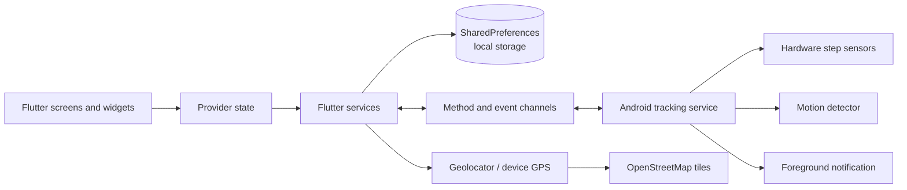

# StrideUp

<p align="center">
  
</p>

<p align="center">
  A privacy-focused, local-first fitness tracker built with Flutter and native Android step sensing.
</p>

<p align="center">
  
  
  
  
</p>

## Preview

| Home | Statistics | Profile & settings |
|:---:|:---:|:---:|
|  |  |  |

## What it does

StrideUp records steps, estimates distance and calories, tracks GPS routes, and turns daily movement into goals and levels. Its account, activity, and route data stay on the device. A foreground Android service supports reliable screen-off tracking, while independent controls let the user disable the ongoing notification or stop step sensors entirely to save battery.

| Area | Capability |
| --- | --- |
| Step tracking | Native Android step detector, cumulative sensor reconciliation, and optional cadence-filtered motion detection |
| Sensitivity | Battery saver, balanced, and high-sensitivity modes |
| Live status | Theme-matched ongoing notification with current steps and calories |
| Routes | Foreground GPS recording with distance, duration, path, and step delta |
| Progress | Daily goal ring, history charts, streaks, levels, and achievements |
| Personalization | Weight, step length, units, theme, daily goal, and tracking controls |
| Session | Persistent local sign-in until the user explicitly signs out |

## Architecture



The Flutter layer owns presentation, application state, calculations, and persistence. Kotlin owns continuous sensor collection, sensor reconciliation, boot recovery, and the foreground step notification. Platform channels keep this boundary small and explicit. See [Architecture](docs/ARCHITECTURE.md) for component, lifecycle, and data-flow diagrams.

## Tracking modes

| Mode | Sensors | Intended use |
| --- | --- | --- |
| Battery saver | Cumulative hardware counter | Lowest power use; updates can arrive in batches |
| Balanced | Per-step detector plus cumulative correction | Recommended mix of responsiveness and reliability |
| High sensitivity | Balanced sensors plus filtered accelerometer cadence | Helps devices that miss steps, with higher battery use |

Step counting and the live step notification are separate settings. Disabling counting unregisters the sensors and stops the service. Disabling only the notification keeps foreground-independent tracking behavior subject to Android device policy.

## Privacy and permissions

StrideUp has no analytics SDK, advertising SDK, or cloud account backend. Account records use a salted password verifier and remain local. This protects against storing plain-text passwords but does not provide the guarantees of a server-backed identity system.

| Permission | Why it is requested |
| --- | --- |
| Physical activity | Read supported step sensors |
| Notifications | Show live step and active-route status on Android 13+ |
| Foreground service | Continue explicitly enabled tracking with the screen off |
| Fine location | Record a route after the user starts a GPS activity |

Read [Security and privacy](docs/SECURITY.md) for storage boundaries and repository secret policy.

## Requirements

- Flutter 3.44 or a compatible stable release
- Dart 3.12 or later
- Android Studio with Android SDK and JDK 21
- An Android 10+ device or emulator; physical hardware is required to validate step sensors

## Set up

```bash
git clone https://github.com/BlackAlpha-debug/strideup.git
cd strideup
flutter pub get
flutter run
```

Validate the project:

```bash
flutter analyze --no-pub
flutter test --no-pub
flutter build apk --debug --no-pub
```

Run the native sensor tests from the `android` directory:

```bash
./gradlew testDebugUnitTest
```

On Windows, use `gradlew.bat testDebugUnitTest`.

## Release builds

```bash
flutter build apk --release --no-pub
```

The APK is written to `build/app/outputs/flutter-apk/app-release.apk`. The repository is configured for local development signing. Before publishing, create a private production keystore outside source control and configure it locally. Never commit a keystore, `key.properties`, `.env` file, Firebase configuration, or API credential.

## Project map

```text
lib/
  models/       Stored activity and profile data
  providers/    Application state and orchestration
  screens/      Home, statistics, routes, levels, and account UI
  services/     Authentication, persistence, location, permissions, platform bridge
  theme/        Color and Material theme definitions
android/app/src/main/kotlin/com/strideup/stride_up/
                Native sensors, foreground service, notification, boot recovery
test/           Flutter unit and widget tests
android/app/src/test/
                Native step-filter and reconciliation tests
docs/           Architecture, security notes, and product images
```

## Further reading

- [Architecture and runtime flows](docs/ARCHITECTURE.md)
- [Security and privacy](docs/SECURITY.md)
- [Implementation notes](IMPLEMENTATION_NOTES.md)
- [Upgrade plan](UPGRADE_PLAN.md)

This project is Android-first. Flutter platform scaffolding is present for other targets, but continuous step sensing and foreground notifications currently depend on the Android implementation.
