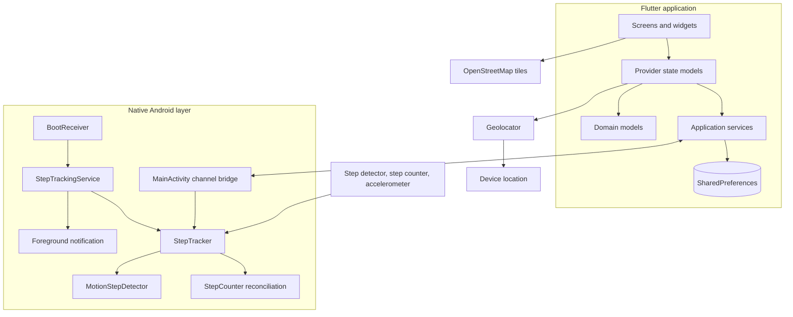
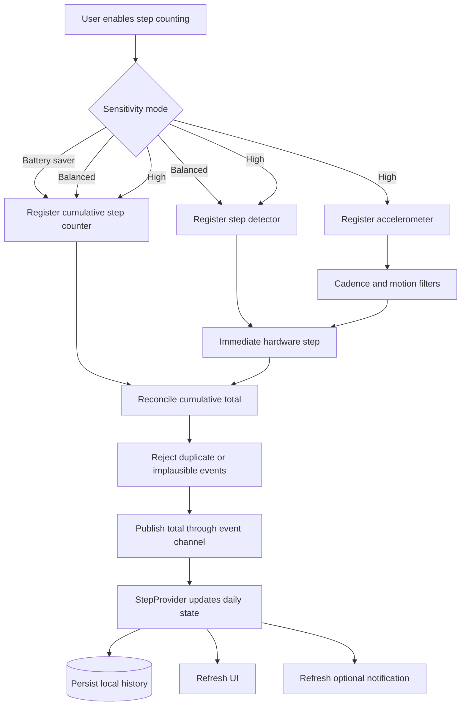
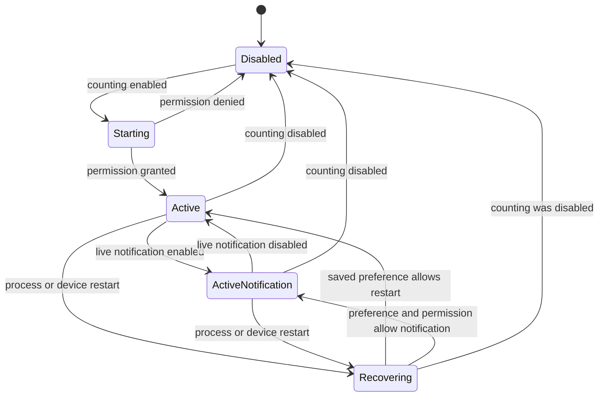
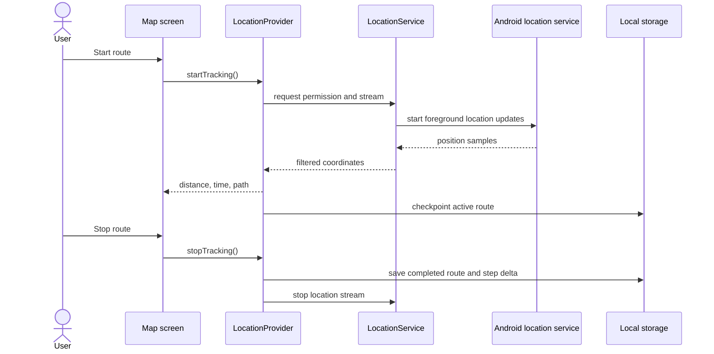
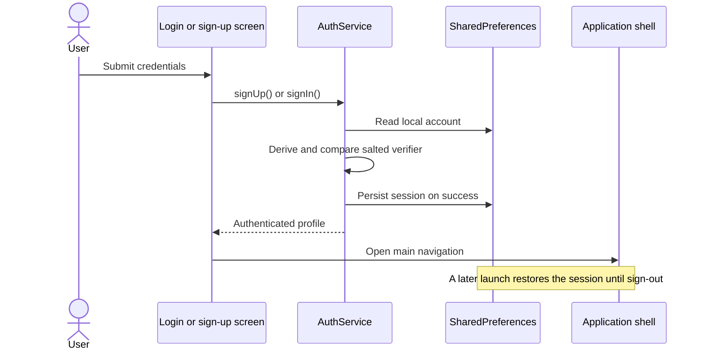

# StrideUp architecture

StrideUp is a local-first Flutter application with a focused native Android layer. Flutter owns the product experience and durable app data. Kotlin owns sensor input and the foreground service required for dependable background collection.

## Component view

## Step processing flow

The cumulative hardware counter is the source used to correct missed real-time events. The detector keeps updates responsive. High sensitivity supplements those sources with cadence-filtered accelerometer events, so it uses more power.

## Background lifecycle

## Route recording sequence

An active route is checkpointed so an interrupted session can be recovered instead of silently discarded.

## Local authentication sequence

## Storage ownership

| Data | Owner | Persistence |
| --- | --- | --- |
| Account and session | `AuthService` / `UserProvider` | Device-local preferences |
| Daily steps and settings | `StepProvider` | Device-local preferences |
| Route history and active checkpoint | `LocationProvider` | Device-local preferences |
| Theme | `ThemeProvider` | Device-local preferences |
| Sensor runtime state | Native Android service | Memory plus minimal restart preferences |

No cloud database is required. Clearing application data removes the local account and activity history.

## Failure handling

- Sensor totals are reconciled to reduce missed or duplicated step events.
- Permission failures return control to the UI and leave the related feature disabled.
- Route checkpoints preserve an in-progress route if the process is interrupted.
- Deserialization uses defaults where possible so one missing setting does not prevent startup.
- Counting can be disabled completely, which unregisters sensors and avoids ongoing collection.
